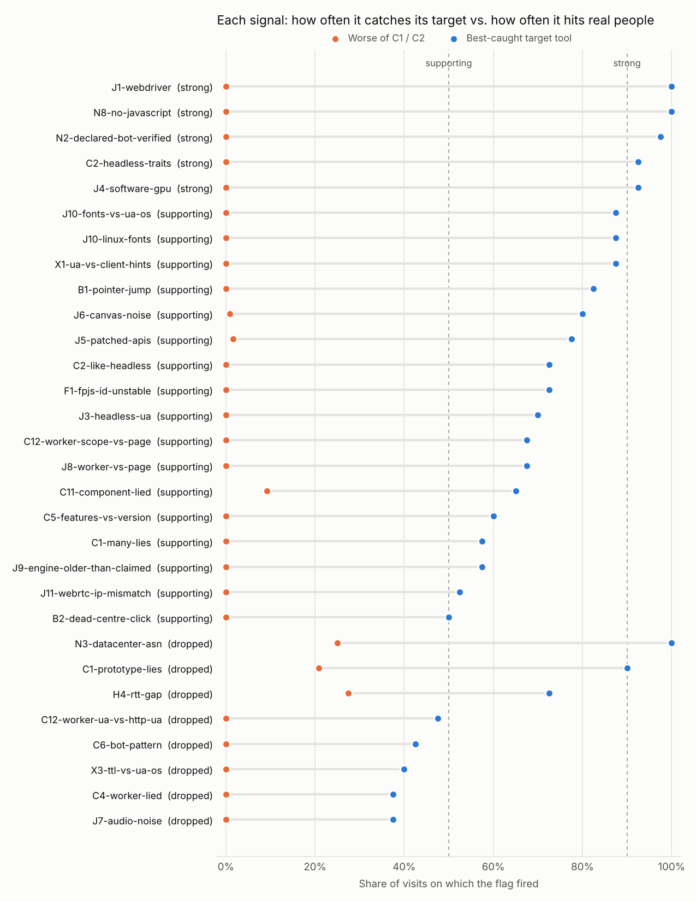
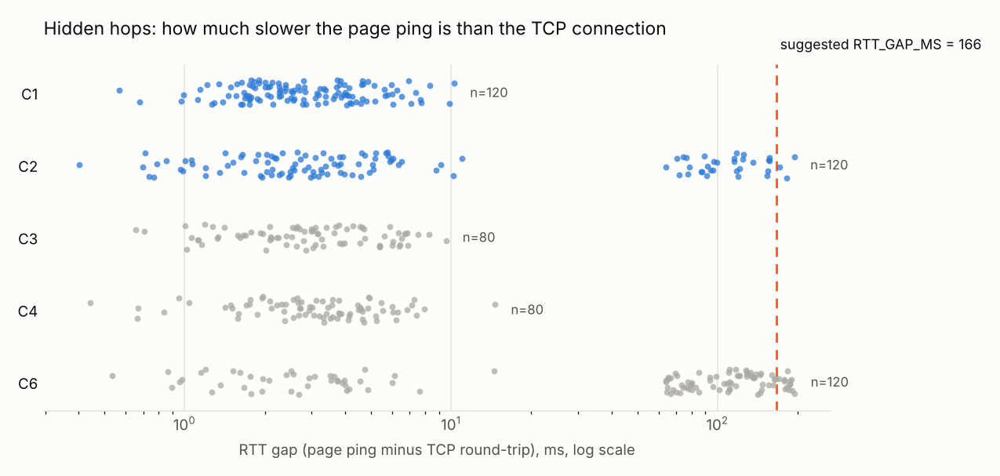

# Phase 6 report: the Anti-Anti-Detect-inator

Generated 2026-10-27 13:33 UTC from `ex.db`. 600 visits, run dates 2026-09-14 to 2026-10-25.

**Exit criteria: 6 of 7 pass.** Enforcement rules wait until all pass.

## Exit criteria

| criterion | status | detail |
|---|---|---|
| N1 verifies all signed C3 sessions | PASS | 100% of 40 signed C3 visits verified; forged and replayed cases are covered by `npm test` |
| Capture completeness >= 99% | PASS | all fields complete |
| Precision >= 98% for suspected-agent (hold-out) | PASS | 100.0% on 130 held-out visits (by run date: 2026-09-14..2026-10-13 fit, 2026-10-14..2026-10-25 test) |
| C2 false positives <= 2% for suspected-agent | PASS | 0.0% of held-out C2 visits |
| Precision >= 98% for anti-detect (hold-out) | PASS | 100.0% on 100 held-out visits (by run date: 2026-09-14..2026-10-13 fit, 2026-10-14..2026-10-25 test) |
| C2 false positives <= 2% for anti-detect | PASS | 0.0% of held-out C2 visits |
| Reproduced on a run 28+ days later | FAIL | 23 strong or supporting signals in the first window; dropped later: C12-worker-ua-vs-http-ua |

## Data by cohort and tool

The plan asks for at least 30 visits per configuration before a rate is trusted.

| cohort | tool | visits |
|---|---|---|
| C1 | chrome-android | 40 |
| C1 | chrome-win | 40 |
| C1 | safari-mac | 40 |
| C2 | brave | 40 |
| C2 | firefox-rfp | 40 |
| C2 | tor | 40 |
| C3 | browserbase | 40 |
| C3 | chatgpt-cloud | 40 |
| C4 | comet | 40 |
| C4 | playwright-headless | 40 |
| C5 | chatgpt-user | 40 |
| C5 | perplexity-user | 40 |
| C6 | adspower | 40 |
| C6 | dolphin | 40 |
| C6 | gologin | 40 |

## Signal grades

Graded on the best-caught tool in the flag's target cohorts, against C1 (people) and C2 (privacy browsers). Strong: target >= 90%, C1 <= 1%, C2 <= 5%. Supporting: target >= 50%, C1 <= 5%, C2 <= 15%.

| flag | side | best_tool | best_tool_rate | pooled_target_rate | c1_rate | c2_rate | grade | low_n |
|---|---|---|---|---|---|---|---|---|
| J1-webdriver | agent | playwright-headless | 100% | 25% | 0% | 0% | strong |  |
| N8-no-javascript | agent | chatgpt-user | 100% | 33% | 0% | 0% | strong |  |
| N2-declared-bot-verified | agent | chatgpt-user | 98% | 32% | 0% | 0% | strong |  |
| C2-headless-traits | agent | playwright-headless | 92% | 23% | 0% | 0% | strong |  |
| J4-software-gpu | agent | chatgpt-cloud | 92% | 44% | 0% | 0% | strong |  |
| J10-fonts-vs-ua-os | both | chatgpt-cloud | 88% | 13% | 0% | 0% | supporting |  |
| J10-linux-fonts | both | chatgpt-cloud | 88% | 10% | 0% | 0% | supporting |  |
| X1-ua-vs-client-hints | both | chatgpt-cloud | 88% | 10% | 0% | 0% | supporting |  |
| B1-pointer-jump | agent | playwright-headless | 82% | 33% | 0% | 0% | supporting |  |
| J6-canvas-noise | antidetect | dolphin | 80% | 64% | 0% | 1% | supporting |  |
| J5-patched-apis | antidetect | adspower | 78% | 59% | 0% | 2% | supporting |  |
| C2-like-headless | agent | playwright-headless | 72% | 24% | 0% | 0% | supporting |  |
| F1-fpjs-id-unstable | antidetect | adspower | 72% | 62% | 0% | 0% | supporting |  |
| J3-headless-ua | agent | playwright-headless | 70% | 12% | 0% | 0% | supporting |  |
| C12-worker-scope-vs-page | antidetect | gologin | 68% | 38% | 0% | 0% | supporting |  |
| J8-worker-vs-page | antidetect | gologin | 68% | 37% | 0% | 0% | supporting |  |
| C11-component-lied | antidetect | adspower | 65% | 43% | 0% | 9% | supporting |  |
| C5-features-vs-version | antidetect | dolphin | 60% | 27% | 0% | 0% | supporting |  |
| C1-many-lies | antidetect | adspower | 57% | 19% | 0% | 0% | supporting |  |
| J9-engine-older-than-claimed | antidetect | dolphin | 57% | 19% | 0% | 0% | supporting |  |
| J11-webrtc-ip-mismatch | antidetect | adspower | 52% | 18% | 0% | 0% | supporting |  |
| B2-dead-centre-click | agent | chatgpt-cloud | 50% | 22% | 0% | 0% | supporting |  |
| N3-datacenter-asn | both | browserbase | 100% | 43% | 0% | 25% | dropped |  |
| C1-prototype-lies | antidetect | adspower | 90% | 79% | 0% | 21% | dropped |  |
| H4-rtt-gap | both | adspower | 72% | 22% | 0% | 28% | dropped |  |
| C12-worker-ua-vs-http-ua | antidetect | gologin | 48% | 16% | 0% | 0% | dropped |  |
| C6-bot-pattern | both | playwright-headless | 42% | 9% | 0% | 0% | dropped |  |
| X3-ttl-vs-ua-os | both | adspower | 40% | 4% | 0% | 0% | dropped |  |
| C4-worker-lied | antidetect | dolphin | 38% | 12% | 0% | 0% | dropped |  |
| J7-audio-noise | antidetect | adspower | 38% | 12% | 0% | 0% | dropped |  |
| C3-stealth-patches | both | browserbase | 35% | 4% | 0% | 0% | dropped |  |
| B3-untrusted-events | agent | comet | 30% | 5% | 0% | 0% | dropped |  |
| J7-gpu-vs-ua-os | antidetect | dolphin | 30% | 10% | 0% | 0% | dropped |  |
| C10-timezone-lied | antidetect | gologin | 25% | 8% | 0% | 0% | dropped |  |
| J2-cdp-runtime | agent | playwright-headless | 22% | 4% | 0% | 0% | dropped |  |
| J12-timezone-vs-ip | both | dolphin | 20% | 2% | 1% | 34% | dropped |  |
| C4-worker-blocked | both | adspower | 0% | 0% | 0% | 18% | dropped |  |
| C7-privacy-browser | antidetect | adspower | 0% | 0% | 0% | 100% | dropped |  |
| C9-webgl-suspect | antidetect | adspower | 0% | 0% | 0% | 0% | dropped |  |
| X4-language-vs-ip-country | both | adspower | 0% | 0% | 2% | 18% | dropped |  |

Full per-cohort rates: `flag_rates_by_cohort.csv`.

## Fitted weights

Logistic regression on earlier runs, tested on later runs, converted to the integer weights and threshold the Node scorer uses. Negative coefficients are clamped to 0 so no visitor can lower its score by triggering a signal on purpose.

### Suspected agent

Split by run date: 2026-09-14..2026-10-13 fit, 2026-10-14..2026-10-25 test. 350 visits to fit, 130 to test. Threshold **5**. Held-out precision 100%, recall 92%, C1 false positives 0%, C2 false positives 0%, AUC 0.973.

The current Node weights on the same held-out visits: precision 90%, recall 87%, C2 false positives 18%.

| flag | weight |
|---|---|
| B1-pointer-jump | 5 |
| N3-datacenter-asn | 4 |
| B2-dead-centre-click | 3 |
| B3-untrusted-events | 3 |
| J4-software-gpu | 3 |
| N2-declared-bot-verified | 3 |
| N8-no-javascript | 3 |
| C2-headless-traits | 2 |
| J1-webdriver | 2 |
| C2-like-headless | 1 |
| C6-bot-pattern | 1 |
| J10-fonts-vs-ua-os | 1 |
| J10-linux-fonts | 1 |
| J3-headless-ua | 1 |
| X1-ua-vs-client-hints | 1 |

Looked more like people than targets (clamped to 0; consider dropping): `C4-worker-blocked`, `H4-rtt-gap`, `J12-timezone-vs-ip`, `X4-language-vs-ip-country`.

### Anti-detect

Split by run date: 2026-09-14..2026-10-13 fit, 2026-10-14..2026-10-25 test. 260 visits to fit, 100 to test. Threshold **10**. Held-out precision 100%, recall 97%, C1 false positives 0%, C2 false positives 0%, AUC 1.000.

The current Node weights on the same held-out visits: precision 78%, recall 100%, C2 false positives 27%.

| flag | weight |
|---|---|
| C1-prototype-lies | 5 |
| C12-worker-scope-vs-page | 5 |
| F1-fpjs-id-unstable | 5 |
| H4-rtt-gap | 5 |
| J5-patched-apis | 4 |
| J6-canvas-noise | 4 |
| J8-worker-vs-page | 4 |
| C5-features-vs-version | 3 |
| C10-timezone-lied | 2 |
| C11-component-lied | 2 |
| C12-worker-ua-vs-http-ua | 2 |
| J10-fonts-vs-ua-os | 2 |
| J9-engine-older-than-claimed | 2 |
| C1-many-lies | 1 |
| C4-worker-lied | 1 |
| J7-gpu-vs-ua-os | 1 |
| X3-ttl-vs-ua-os | 1 |

Looked more like people than targets (clamped to 0; consider dropping): `C4-worker-blocked`, `C7-privacy-browser`, `J12-timezone-vs-ip`, `N3-datacenter-asn`, `X4-language-vs-ip-country`.

## System 1 model: percentages per visit

A calibrated classifier gives every visit a percentage for human, agent and anti-detect. Held-out runs (by run date: 2026-09-14..2026-10-13 fit, 2026-10-14..2026-10-25 test; 439 visits to fit, 161 to test). Lower log loss and Brier are better; calibration error is how far stated percentages sit from how often they were right.

| model | log loss | Brier | calibration error | accuracy | precision human | precision agent | precision antidetect | recall human | recall agent | recall antidetect |
|---|---|---|---|---|---|---|---|---|---|---|
| logistic (exported to Node) | 0.114 | 0.056 | 2% | 97% | 93% | 100% | 100% | 100% | 93% | 97% |
| boosted | 0.408 | 0.097 | 4% | 95% | 93% | 95% | 100% | 96% | 93% | 97% |

`tags.csv` uses the **logistic** model (lower held-out log loss). Reliability of the exported model on held-out runs: when it said about X%, how often was it right?

| stated | visits | mean_stated | actually_right |
|---|---|---|---|
| 80%-90% | 1 | 80% | 0% |
| 90%-100% | 160 | 99% | 98% |

Tags by cohort (`uncertain` = top class under 60%; a verified signature always wins):

| cohort | agent | agent (verified: chatgpt) | antidetect | human |
|---|---|---|---|---|
| C1 | 0 | 0 | 0 | 120 |
| C2 | 0 | 0 | 0 | 120 |
| C3 | 40 | 40 | 0 | 0 |
| C4 | 71 | 0 | 0 | 9 |
| C5 | 80 | 0 | 0 | 0 |
| C6 | 0 | 0 | 120 | 0 |

**Percentages reflect the cohort mix you tested with.** Real traffic is mostly people, so set the expected mix before trusting live numbers: `--priors human=0.97,agent=0.02,antidetect=0.01` here, `MODEL_PRIORS` in Node.

**Live in Node:** copy `model.json` to the server and set `MODEL_FILE=/var/lib/capture-app/model.json` in `/etc/capture-app.env`, then restart the app. Every verdict gains `model.probabilities`, `model.tag` and `model.reasons`. `parity.json` lets `npm run test:model` confirm Node matches Python.

## Applying the fitted weights

To apply: set each flag's `w:` in `client/stop.js` (page checks) or `server/scoring.js` (server checks), and set `THRESHOLDS.suspectedAgent` / `THRESHOLDS.antiDetect` to the thresholds above. Full values: `weights.json`.

## Thresholds from data

**RTT gap (H4):** p99 of C1+C2 gaps; set RTT_GAP_MS=166 in /etc/capture-app.env.

| cohort | p50 | p90 | p99 | n |
|---|---|---|---|---|
| C1 | 2.7 | 6.0 | 9.6 | 120 |
| C2 | 3.8 | 119.9 | 179.8 | 120 |
| C3 | 3.0 | 6.4 | 8.5 | 80 |
| C4 | 3.3 | 6.1 | 9.3 | 80 |
| C6 | 78.5 | 170.6 | 190.4 | 120 |

**Speed-of-light ratio (H5):** TCP round-trip divided by the physical floor. H5 flags values under 0.9.

_No data._

## Population checks

### P1 device linkage

Visits sharing every stable value (JA4T, TTL, GPU, fonts, network, CPU count) inside one day while claiming several identities. Leads to inspect, not verdicts: two people with the same laptop on the same ISP can collide.

| device_key | window | visits | identities | canvas_hashes | ja4s | ips | cohorts | tools | renderer | ja4t | claimed_identities |
|---|---|---|---|---|---|---|---|---|---|---|---|
| b8bc43fe1db4 | 2026-10-15 00:00:00+00:00 | 5 | 4 | 5 | 5 | 5 | C6 | adspower | ANGLE (NVIDIA, GeForce RTX 3060) | 64240_2-4-8-1-3_1460_7 | 5 |
| 676179c320ee | 2026-10-06 00:00:00+00:00 | 4 | 4 | 4 | 4 | 4 | C6 | gologin | ANGLE (NVIDIA, GeForce RTX 4070) | 64240_2-4-8-1-3_1460_8 | 4 |
| 2e0837d47a5e | 2026-10-07 00:00:00+00:00 | 3 | 3 | 1 | 1 | 3 | C3 | browserbase,chatgpt-cloud | ANGLE (Google, SwiftShader) | 65535_2-4-8-1-3_1440_7 | 3 |
| 676179c320ee | 2026-09-26 00:00:00+00:00 | 3 | 3 | 3 | 3 | 3 | C6 | gologin | ANGLE (NVIDIA, GeForce RTX 4070) | 64240_2-4-8-1-3_1460_8 | 3 |
| 676179c320ee | 2026-09-28 00:00:00+00:00 | 3 | 3 | 3 | 3 | 3 | C6 | gologin | ANGLE (NVIDIA, GeForce RTX 4070) | 64240_2-4-8-1-3_1460_8 | 3 |
| 676179c320ee | 2026-09-30 00:00:00+00:00 | 3 | 3 | 3 | 3 | 3 | C6 | gologin | ANGLE (NVIDIA, GeForce RTX 4070) | 64240_2-4-8-1-3_1460_8 | 3 |
| dad7f395ee32 | 2026-09-20 00:00:00+00:00 | 3 | 3 | 1 | 1 | 3 | C3 | browserbase,chatgpt-cloud | ANGLE (Google, SwiftShader) | 65535_2-4-8-1-3_1440_7 | 3 |
| dad7f395ee32 | 2026-10-02 00:00:00+00:00 | 3 | 3 | 1 | 1 | 3 | C3 | browserbase | ANGLE (Google, SwiftShader) | 65535_2-4-8-1-3_1440_7 | 3 |
| dad7f395ee32 | 2026-10-04 00:00:00+00:00 | 3 | 3 | 1 | 1 | 3 | C3 | browserbase,chatgpt-cloud | ANGLE (Google, SwiftShader) | 65535_2-4-8-1-3_1440_7 | 3 |
| dad7f395ee32 | 2026-10-05 00:00:00+00:00 | 3 | 3 | 1 | 1 | 3 | C3 | browserbase,chatgpt-cloud | ANGLE (Google, SwiftShader) | 65535_2-4-8-1-3_1440_7 | 3 |
| db8a054a44de | 2026-10-09 00:00:00+00:00 | 3 | 3 | 3 | 3 | 3 | C6 | dolphin | ANGLE (NVIDIA, GeForce RTX 3060) | 64240_2-4-8-1-3_1460_8 | 3 |
| dad7f395ee32 | 2026-09-22 00:00:00+00:00 | 3 | 2 | 1 | 1 | 3 | C3 | browserbase,chatgpt-cloud | ANGLE (Google, SwiftShader) | 65535_2-4-8-1-3_1440_7 | 2 |

### P1 by device ID (CreepJS and FingerprintJS)

Visits sharing a CreepJS stable ID or a FingerprintJS visitor ID while claiming several user agents or IPs. CreepJS leaves components it caught lying out of its stable ID, so a rotating profile often keeps one ID.

| id_type | id | visits | user_agents | ips | ja4s | cohorts | tools |
|---|---|---|---|---|---|---|---|
| creep | c931398d802260ee | 26 | 6 | 26 | 26 | C6 | gologin |
| creep | 0019ccb34e2ff687 | 25 | 6 | 25 | 25 | C6 | dolphin |
| creep | 635d75958003ae0f | 21 | 6 | 21 | 21 | C6 | adspower |
| creep | a1d42dcb53301b9c | 25 | 2 | 25 | 1 | C3,C4 | browserbase,chatgpt-cloud,playwright-headless |
| fpjs | 5614607b266581eb | 25 | 2 | 25 | 1 | C3,C4 | browserbase,chatgpt-cloud,playwright-headless |
| creep | 7641262d94e1335f | 20 | 2 | 20 | 1 | C1,C2,C4 | brave,chrome-win,comet,firefox-rfp,tor |
| creep | 69b2d848ed45fbf2 | 18 | 2 | 18 | 1 | C3,C4 | browserbase,chatgpt-cloud,playwright-headless |
| creep | aa92bc10d6d0271f | 18 | 2 | 18 | 1 | C1,C2,C3,C4 | brave,browserbase,chrome-win,comet,firefox-rfp,playwright-headless,tor |
| creep | fca74b61ec8376ab | 18 | 2 | 18 | 1 | C3,C4 | browserbase,chatgpt-cloud,playwright-headless |
| fpjs | 71d799fa5818679d | 18 | 2 | 18 | 1 | C3,C4 | browserbase,chatgpt-cloud,playwright-headless |
| fpjs | 7c8c5c91f97fe5e7 | 18 | 2 | 18 | 1 | C3,C4 | browserbase,chatgpt-cloud,playwright-headless |
| creep | 2b5081e8809350e3 | 17 | 2 | 17 | 1 | C1,C2 | brave,firefox-rfp,safari-mac,tor |
| creep | 4183ba4e699a29ad | 17 | 2 | 17 | 1 | C1,C2 | brave,firefox-rfp,safari-mac,tor |
| creep | eeb8b81ff40c11df | 16 | 2 | 16 | 1 | C3,C4 | browserbase,chatgpt-cloud,playwright-headless |
| fpjs | 9fd065cad5c66b80 | 16 | 2 | 16 | 1 | C3,C4 | browserbase,chatgpt-cloud,playwright-headless |
| creep | f27cb7878b5b27d1 | 13 | 2 | 13 | 1 | C1,C2 | brave,firefox-rfp,safari-mac,tor |
| creep | aced7c8d636394cc | 12 | 2 | 12 | 1 | C1,C2 | brave,chrome-win,firefox-rfp,tor |
| creep | 5f9e1d74fd9e8741 | 11 | 2 | 11 | 1 | C1,C2 | brave,chrome-win,firefox-rfp,tor |
| creep | c4d0a1a2efb782c9 | 10 | 2 | 10 | 1 | C2 | brave,firefox-rfp,tor |
| creep | c08027226f017585 | 9 | 2 | 9 | 9 | C6 | adspower,dolphin |

### P2 velocity

Busiest hours per JA4 and per network, with C1's 99th-percentile hourly count for scale.

| ja4 | window | visits | cohorts | c1_p99 |
|---|---|---|---|---|
| t13d1516h2_8daaf6152771_e5627efa2ab1 | 2026-10-25 02:00:00+00:00 | 5 | C2,C3,C4,C5 | 2.490000000000002 |
| t13d1516h2_8daaf6152771_e5627efa2ab1 | 2026-10-21 06:00:00+00:00 | 5 | C1,C2,C4,C5 | 2.490000000000002 |
| t13d1516h2_8daaf6152771_e5627efa2ab1 | 2026-09-26 02:00:00+00:00 | 5 | C1,C2,C4 | 2.490000000000002 |
| t13d1516h2_8daaf6152771_e5627efa2ab1 | 2026-10-21 09:00:00+00:00 | 4 | C1,C2,C3 | 2.490000000000002 |
| t13d1516h2_8daaf6152771_e5627efa2ab1 | 2026-10-12 00:00:00+00:00 | 4 | C2,C4 | 2.490000000000002 |
| t13d1516h2_8daaf6152771_e5627efa2ab1 | 2026-09-23 00:00:00+00:00 | 4 | C1,C2,C3,C4 | 2.490000000000002 |
| t13d1516h2_8daaf6152771_e5627efa2ab1 | 2026-09-24 05:00:00+00:00 | 4 | C1,C2,C5 | 2.490000000000002 |
| t13d1516h2_8daaf6152771_e5627efa2ab1 | 2026-10-23 03:00:00+00:00 | 4 | C1,C2,C3,C5 | 2.490000000000002 |
| t13d1516h2_8daaf6152771_e5627efa2ab1 | 2026-09-20 09:00:00+00:00 | 4 | C1,C2,C3,C5 | 2.490000000000002 |
| t13d1516h2_8daaf6152771_e5627efa2ab1 | 2026-09-28 09:00:00+00:00 | 4 | C2,C3,C4 | 2.490000000000002 |

| asn | window | visits | cohorts | c1_p99 |
|---|---|---|---|---|
| 16509.0 | 2026-10-02 09:00:00+00:00 | 3 | C2,C5 | 2.0 |
| 16509.0 | 2026-10-04 05:00:00+00:00 | 3 | C3,C5 | 2.0 |
| 16509.0 | 2026-09-21 00:00:00+00:00 | 3 | C3,C5 | 2.0 |
| 7018.0 | 2026-09-19 07:00:00+00:00 | 2 | C4 | 2.0 |
| 7922.0 | 2026-09-28 03:00:00+00:00 | 2 | C6 | 2.0 |
| 16509.0 | 2026-10-01 08:00:00+00:00 | 2 | C3,C5 | 2.0 |
| 16509.0 | 2026-10-01 07:00:00+00:00 | 2 | C2,C5 | 2.0 |
| 7922.0 | 2026-09-30 09:00:00+00:00 | 2 | C6 | 2.0 |
| 701.0 | 2026-10-21 06:00:00+00:00 | 2 | C1,C2 | 2.0 |
| 16509.0 | 2026-09-30 06:00:00+00:00 | 2 | C5 | 2.0 |

### P3 tool traces

Values seen in at least 80% of one tool's visits and at most 1% of everyone else's.

| tool | cohort | field | value | share_in_tool | share_elsewhere | tool_visits |
|---|---|---|---|---|---|---|
| adspower | C6 | ja4t | 64240_2-4-8-1-3_1460_7 | 100% | 0% | 40 |
| adspower | C6 | non_native | adspower-hook;get userAgent | 100% | 0% | 40 |
| dolphin | C6 | non_native | dolphin-hook;get userAgent | 100% | 0% | 40 |
| gologin | C6 | webgl_renderer | ANGLE (NVIDIA, GeForce RTX 4070) | 100% | 0% | 40 |
| gologin | C6 | non_native | gologin-hook;get userAgent | 100% | 0% | 40 |
| gologin | C6 | creep_gpu | ANGLE (NVIDIA, GeForce RTX 4070) | 100% | 0% | 40 |

## Rarity and impossible combinations

Measured against C1 and C2 with leave-one-out (a visit is never compared with itself). **Surprisal** is the average -log2 P(value) per attribute; values no person showed cost the most. **Impossible pairs** are two coarse values that each appear among people at least 3 times but never together (for example a macOS user agent with an NVIDIA GPU). With a small reference set, rare real setups land here too: read both as rankings until C1/C2 hold a few hundred visits. Per visit: `rarity_by_visit.csv`; also in `tags.csv`.

| cohort | visits | median_bits | p90_bits | median_pct_vs_people | any_unseen_value | any_impossible_pair |
|---|---|---|---|---|---|---|
| C1 | 120 | 3.76 | 4.39 | 0.67 | 2% | 0% |
| C2 | 120 | 3.48 | 3.83 | 0.42 | 0% | 0% |
| C3 | 80 | 7.01 | 7.03 | 1.0 | 100% | 100% |
| C4 | 80 | 6.99 | 7.03 | 1.0 | 100% | 100% |
| C5 | 80 | 1.94 | 2.1 | 0.0 | 0% | 100% |
| C6 | 120 | 7.46 | 7.67 | 1.0 | 100% | 100% |

Share of each cohort's visits with each impossible pair:

| pair | C3 | C4 | C5 | C6 |
|---|---|---|---|---|
| gpu_family & hardware_concurrency | 0.0 | 0.0 | 0.0 | 1.0 |
| ua_os & font_os | 1.0 | 1.0 | 0.0 | 0.533 |
| ua_os & gpu_family | 0.025 | 0.138 | 0.0 | 0.533 |
| ua_os & hardware_concurrency | 0.625 | 0.425 | 0.0 | 0.533 |
| ua_os & ja4t | 1.0 | 1.0 | 1.0 | 0.367 |
| ua_os & ttl_initial | 0.375 | 0.575 | 0.462 | 0.533 |

Attribute entropy among people (bits; higher = more identifying). `unique_share` is the share of people whose value nobody else had. Full table: `attribute_entropy.csv`.

| attribute | reference_visits | distinct | entropy_bits | normalized | unique_share | present_all |
|---|---|---|---|---|---|---|
| h:css | 240 | 29 | 4.612 | 0.583 | 1% | 87% |
| h:cssMedia | 240 | 29 | 4.612 | 0.583 | 1% | 87% |
| h:deviceOfTimezone | 240 | 29 | 4.612 | 0.583 | 1% | 87% |
| h:domRect | 240 | 29 | 4.612 | 0.583 | 1% | 87% |
| h:canvasWebgl | 240 | 29 | 4.612 | 0.583 | 1% | 87% |
| h:canvas2d | 240 | 29 | 4.612 | 0.583 | 1% | 87% |
| h:resistance | 240 | 29 | 4.612 | 0.583 | 1% | 87% |
| h:styleSystem | 240 | 29 | 4.612 | 0.583 | 1% | 87% |
| h:svg | 240 | 29 | 4.612 | 0.583 | 1% | 87% |
| h:voices | 240 | 29 | 4.612 | 0.583 | 1% | 87% |
| h:workerScope | 240 | 29 | 4.612 | 0.583 | 1% | 87% |
| h:windowFeatures | 240 | 29 | 4.612 | 0.583 | 1% | 87% |
| h:consoleErrors | 240 | 29 | 4.612 | 0.583 | 1% | 87% |
| h:canvasWebglParameters | 240 | 29 | 4.612 | 0.583 | 1% | 87% |
| h:features | 240 | 29 | 4.612 | 0.583 | 1% | 87% |
| h:fonts | 240 | 29 | 4.612 | 0.583 | 1% | 87% |
| h:mimeTypes | 240 | 29 | 4.612 | 0.583 | 1% | 87% |
| h:media | 240 | 29 | 4.612 | 0.583 | 1% | 87% |
| h:maths | 240 | 29 | 4.612 | 0.583 | 1% | 87% |
| h:intl | 240 | 29 | 4.612 | 0.583 | 1% | 87% |

## Current verdicts by cohort

What the Node scorer stored, before any reweighting.

| cohort | agent + anti-detect | anti-detect | no evidence | suspected agent | verified agent |
|---|---|---|---|---|---|
| C1 | 0 | 0 | 120 | 0 | 0 |
| C2 | 32 | 8 | 80 | 0 | 0 |
| C3 | 14 | 0 | 5 | 21 | 40 |
| C4 | 0 | 0 | 25 | 55 | 0 |
| C5 | 0 | 0 | 3 | 77 | 0 |
| C6 | 25 | 95 | 0 | 0 | 0 |

## Capture completeness

| field | scope | n | complete |
|---|---|---|---|
| ja4 | all visits | 600 | 100% |
| ja4h | all visits | 600 | 100% |
| ja4t | all visits | 600 | 100% |
| syn_ttl | all visits | 600 | 100% |
| tcp_rtt_ms | all visits | 600 | 100% |
| t1_ms | all visits | 600 | 100% |
| page_rtt_min_ms | visits that ran JavaScript | 520 | 100% |
| webgl_renderer | visits that ran JavaScript | 520 | 100% |
| t3_ms | visits that ran JavaScript | 520 | 100% |
