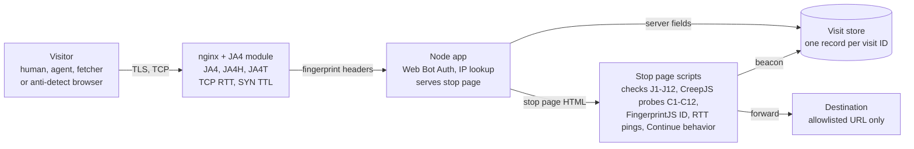

# Agent and anti-detect detection: test plan

Oct 26, 2026. Live copy: https://claude.ai/artifact/QgiJEHDHrDN7goakNWpqw9 (this file is a snapshot; the appendix maps each test to the code).

## Scope and assumptions

One app labels every visit with three verdicts: verified agent, suspected agent, and anti-detect browser. It also stores a JA4 network fingerprint and hop timing for each visit. Tests run cheapest and most passive first, because each layer supplies the baseline the next layer is judged against.

- **Two modes, one capture path.** Mode 1 is the detector on your own sites. Mode 2 is the redirect page that agents are sent through. Both write to the same visit record.
- **"Time between hops" means two measurements.** (a) Network hops: TCP round-trip time and IP TTL at the server, compared with round-trip time measured in the page, to expose proxies and relays. (b) Redirect hops: timestamps from short-link hit to stop page, beacon and forward, to profile how fast agents act.
- **Ground truth comes from controlled runs.** Thresholds are set only from sessions whose operator is known. No threshold is tuned on live traffic.
- **Out of scope:** blocking or enforcement. This plan measures and labels. Enforcement rules come after the exit criteria are met.

## Test environment and ground-truth cohorts

Every signal is scored against six labeled cohorts. Run at least 30 sessions per configuration, varying network (home broadband, mobile, VPN) and time of day. The privacy cohort exists to measure false positives: those browsers block or randomize the same surfaces anti-detect tools fake.

| Cohort | Members to run | What it calibrates |
| --- | --- | --- |
| C1 Human baseline | Chrome, Edge and Firefox on Windows and macOS; Safari on macOS and iOS; Chrome on Android. Real hardware, real people clicking. | Normal values for every signal |
| C2 Privacy browsers | Brave, Tor Browser, Firefox with resistFingerprinting, Safari with iCloud Private Relay, a commercial VPN | False-positive rate |
| C3 Cloud agents | ChatGPT agent / Work cloud browser, a ChatGPT dot, Browserbase (standard and Verified), Anchor Browser with Web Bot Auth on | Signed vs unsigned cloud browsers |
| C4 Local agents | Perplexity Comet, ChatGPT Atlas agent mode, Playwright and Puppeteer (headless and headed), puppeteer-extra stealth | Automation on a real user machine |
| C5 Server fetchers | ChatGPT-User, Perplexity-User, Grok (prompt each assistant to open the link) | No-JavaScript visits |
| C6 Anti-detect browsers | AdsPower, Dolphin Anty, GoLogin, Octo Browser, Multilogin; each alone and paired with a residential proxy | Spoofing signals |

- **Label at source.** Each run gets a one-time link tagged with cohort, tool, version, OS and network, so the visit record carries its label.
- **Re-run monthly.** Agent and anti-detect vendors ship changes often. A signal that worked in October can be gone by December.
- **Licensing.** C6 tools need paid accounts. Check each tool's terms before running it against your own test site.

## Capture architecture

nginx with the FoxIO JA4 module sits directly on the internet and adds network fingerprints as request headers. The Node app checks signatures and serves the stop page. The page script posts its results back under the same visit ID.



nginx must overwrite the fingerprint headers with `proxy_set_header`, and the app must listen only on localhost. Otherwise a visitor could send fake fingerprint headers of its own.

| Field group | Fields | Source | Tests |
| --- | --- | --- | --- |
| Identity | visit ID, link ID, cohort label, timestamps T0 to T5 | App | All |
| Signature | `Signature-Agent`, verdict, key ID, failure reason | App (`identifyAgent`) | N1 |
| Network | IP, ASN, ASN type, geolocation, JA4, JA4H, JA4T, TTL, hop estimate, TCP RTT | nginx headers + enrichment | N2 to N7, X1 to X4, H1, H2, H5 |
| Headers | User-Agent, Client Hints, Accept-Language, header order | App | N5, X1, X4 |
| Page | J1 to J12 results, WebGL renderer, canvas and audio hashes, worker values, WebRTC IPs | Beacon | Phase 3 |
| Probes | CreepJS summary (lies, headless/stealth ratings, worker scope, resistance, about 35 component hashes, stable and fuzzy IDs), FingerprintJS visitor ID | Beacon (`phase: "probes"`) | Phase 3b, P1b, P4, P5 |
| Timing | 10 in-page RTT samples, subresource list with times | Beacon + access log | H3, H4, H6, H7 |
| Behavior | pointer path summary, click offset, `isTrusted` counts, key-gap spread | Beacon | Phase 5 |

## Test order

Run the phases in this order. Do not start a phase until the one before it records its fields on at least 99% of sessions, because later tests are comparisons against earlier captures. Unless a row says otherwise, a test passes when it meets the strong-signal rule in Scoring.

### Phase 1: passive network capture (no JavaScript)

| ID | Test | How | Catches |
| --- | --- | --- | --- |
| N1 | Web Bot Auth signature | `identifyAgent()` on every request; replay, forged and wrong-host cases from the test suite | Agents. Target: 100% of signed C3 sessions verified, 0 forged ones accepted |
| N2 | Declared tokens and IP lists | Match User-Agent tokens; check source IP against operator-published ranges | Agents (C5) |
| N3 | IP intelligence | ASN type (datacenter, residential, mobile), VPN and proxy lists, IP reputation | Both |
| N4 | JA4 (TLS client) | Build a table of JA4 per browser family and version from C1; flag a JA4 never seen for the claimed browser | Both |
| N5 | JA4H (HTTP client) | Header order, header count, cookie and Accept-Language presence | Both |
| N6 | JA4T and IP TTL | TCP SYN window, options, MSS; initial TTL (64 for Linux and macOS, 128 for Windows) | Both. Origin-direct only: a CDN or TCP proxy replaces these values with its own |
| N7 | HTTP/2 fingerprint | SETTINGS values, window update, pseudo-header order | Both. Needs a front end that exposes HTTP/2 frames (open item) |
| N8 | JavaScript ran? | Did the stop page's script and beacon arrive? | Agents (C5 fetchers send none) |

### Phase 2: cross-layer consistency (server side)

| ID | Test | How | Catches |
| --- | --- | --- | --- |
| X1 | User-Agent vs Client Hints | Claimed OS in User-Agent vs `Sec-CH-UA-Platform` | Both. ChatGPT's agent was seen claiming macOS while hints said Linux |
| X2 | User-Agent vs JA4 | Claimed browser and version vs the N4 lookup table | Both |
| X3 | User-Agent vs JA4T and TTL | Claimed OS vs TCP-layer OS guess | Both |
| X4 | Language vs IP country | `Accept-Language` vs IP geolocation | Both. Expect noise from travellers and expats |

### Phase 3: client static checks (stop page script)

| ID | Test | How | Catches |
| --- | --- | --- | --- |
| J1 | webdriver flag | `navigator.webdriver` | Agents |
| J2 | DevTools Protocol trace | Error-stack getter fired by `console.debug` | Agents. Weak: did not fire under Playwright in the earlier test |
| J3 | Headless markers | HeadlessChrome UA, zero outer window, 800×600 screen | Agents |
| J4 | Software GPU | WebGL renderer matches SwiftShader or llvmpipe | Agents (GPU-less cloud machines) |
| J5 | Native function integrity | `Function.prototype.toString` output, property descriptors, Proxy traps on `navigator` and canvas APIs | Anti-detect (JavaScript-injection tools) |
| J6 | Canvas consistency | Draw the same scene twice and compare; hash against C1 values for the claimed GPU | Anti-detect |
| J7 | WebGL and audio consistency | Renderer string vs WebGL parameter limits; audio sample hash vs C1 | Anti-detect |
| J8 | Worker vs page | Read UA, platform, languages, timezone, `hardwareConcurrency` in a Web Worker and an iframe; compare with the page | Anti-detect |
| J9 | Engine version lag | Probe features new in the claimed Chrome version | Anti-detect |
| J10 | Fonts vs claimed OS | Check for fonts that ship only with the claimed OS | Anti-detect |
| J11 | WebRTC leak | Compare ICE candidate IPs with the request IP | Anti-detect with a proxy |
| J12 | Timezone vs IP | `Intl` timezone vs IP geolocation | Both |

### Phase 3b: CreepJS-based probes and device IDs (stop page script)

`/probes.js` runs CreepJS's collectors (MIT; vendored in `vendor/creepjs`) and `/s/f.js` serves FingerprintJS v5 (MIT). Both run on your server; neither sends visitor data anywhere else. Module-by-module coverage, patches and test results: `docs/PROBES.md`.

| ID | Test | How | Catches |
| --- | --- | --- | --- |
| C1 | Prototype lies | CreepJS lie detector on about 200 APIs: `toString` tampering, descriptor and prototype-chain checks, Proxy traps, class-extends and `instanceof` errors | Anti-detect (any JavaScript patching) |
| C2 | Headless traits | CreepJS headless and like-headless ratings (webdriver, headless UA in page or worker, no plugins, permission bug, SwiftShader...) | Agents |
| C3 | Stealth patches | CreepJS stealth rating: traces left by puppeteer-extra-style evasions | Both |
| C4 | Worker scope | Service, then shared, then dedicated worker values; OS, engine, version and platform-version lies inside the worker; worker blocked | Anti-detect; emulators that only control dedicated workers |
| C5 | Feature version | CSS and JS feature sets vs the version the worker's UA claims | Anti-detect. Limit: CreepJS's version tables stop near Chrome 115; J9 covers later versions |
| C6 | Bot pattern | CreepJS bot hash (lied worker, lied platform version, `toString` Proxy, extreme lie count, blocked worker) | Both |
| C7 | Resistance | Brave, Firefox resistFingerprinting, Tor Browser; known anti-fingerprinting extensions | C2 identification (weight 0); extensions (anti-detect) |
| C8 | Trash values | Values CreepJS rejects as impossible (e.g. suspicious GPU strings) | Both |
| C9 | WebGL suspect | Low-confidence GPU string or WebGL parameter/extension lie | Anti-detect |
| C10 | Timezone lie | Measured timezone location vs reported zone | Anti-detect |
| C11 | Component lied | Any CreepJS component (canvas, audio, fonts, screen, navigator, voices...) marked lied | Anti-detect |
| C12 | Worker vs page vs request | Service/shared worker UA, cores, memory, timezone and GPU vs the page; worker UA vs the HTTP User-Agent (server side) | Anti-detect; CDP user-agent overrides, which do not reach workers |
| F1 | Device ID stability | FingerprintJS visitor ID read twice in one page load | Anti-detect (per-read noise). Weak: FingerprintJS already discards noisy canvas |

Device IDs: CreepJS's stable ID (leaves out components it caught lying), its fuzzy hash, and the FingerprintJS visitor ID go into every verdict (`verdict.ids`) and feed P1.

### Phase 4: hop timing

See the hop timing tests (H1 to H7) below. They run here because they reuse the Phase 1 network capture and the Phase 3 script.

### Phase 5: behavior (stop page with a "Continue" button)

| ID | Test | How | Catches |
| --- | --- | --- | --- |
| B1 | Pointer path | Pointer moves before the click: none, a single jump, or a curve | Agents |
| B2 | Click position | Distance from the button's exact center | Agents |
| B3 | Event trust | `isTrusted` on pointer, click and key events | Agents (script-injected events) |
| B4 | Typing cadence | Spread of keystroke gaps on an optional text field | Agents |

### Phase 6: population analysis (needs data from all cohorts)

| ID | Test | How | Catches |
| --- | --- | --- | --- |
| P1 | Device linkage | Visits with different visitor IDs that share stable values (JA4T, TTL, GPU, fonts, ASN) | Anti-detect (many profiles on one machine) |
| P2 | Velocity | Visits per JA4, per ASN and per linked device per hour | Both |
| P3 | Known tool traces | Signal combinations unique to each C6 tool, learned from labeled runs | Anti-detect |
| P1b | Device-ID linkage | Visits sharing a CreepJS stable ID or FingerprintJS visitor ID across several user agents or IPs | Anti-detect; agent fleets built from one image |
| P4 | Rarity | Entropy per attribute and per-visit surprisal (mean -log2 P(value)) against C1 and C2, leave-one-out; values no person showed | Anti-detect (noise makes unique hashes) |
| P5 | Impossible combinations | Coarse value pairs that each appear among people but never together (macOS UA + NVIDIA GPU, Windows UA + TTL 64, UA OS + JA4T...) | Both |

## Hop timing tests

The key test compares round-trip time seen by the server's TCP stack with round-trip time measured inside the page. A proxy or relay ends the TCP connection itself, so the server sees only the short last hop. The page's own timing still covers the whole path back to the real browser.

| ID | Measurement | Where and how | What it exposes |
| --- | --- | --- | --- |
| H1 | TCP RTT | nginx `$tcpinfo_rtt` (microseconds, Linux `TCP_INFO`), logged per request | Distance to whatever opened the TCP connection |
| H2 | IP TTL and hop estimate | Saved SYN (`TCP_SAVE_SYN`); hops = nearest initial TTL (64, 128 or 255) minus observed TTL | OS mismatch; extra hops from tunnels |
| H3 | In-page RTT | 10 WebSocket ping-pongs, or 10 `fetch` calls to a `204` endpoint with `no-store`; keep the minimum | Full path to the real browser |
| H4 | RTT gap | H3 minimum minus H1 (formula below) | Proxy, VPN or remote-browser relay |
| H5 | Speed-of-light check | H1 vs the shortest possible RTT for the IP's geolocated distance (formula below) | Wrong IP geolocation, or a spoofed location |
| H6 | Redirect hop timeline | Server timestamps for T0 short-link hit, T1 stop page sent, T3 beacon received, T4 Continue clicked, T5 forward; the page reports T2 script start | How fast each cohort reads and acts; fetchers stop after T1 |
| H7 | Subresource pattern | Which CSS, image and favicon requests arrive, in what order, with what gaps | Fetchers and stripped-down agent browsers |

```latex
\Delta_{\text{hop}} = \min_{i=1..10} \text{RTT}_{\text{page},i} - \text{RTT}_{\text{TCP}}
```

```latex
\text{RTT}_{\min}\,(\text{ms}) \approx \frac{d_{\text{km}}}{100}
```

All formulas used anywhere in the project, with every symbol defined, are in `docs/MATH.md`. The second formula comes from light in fiber covering about 200 km per millisecond, counted out and back. A measured H1 below that floor means the IP's location is wrong. A large gap in H4 means another hop sits between the server and the browser. Set the H4 threshold from the C1 and C2 distributions: browser overhead adds a few milliseconds even on direct connections.

Test hypotheses to confirm or reject:

- Residential-proxy C6 sessions show a large H4 gap. Unproxied C6 sessions do not.
- C3 cloud agents show a datacenter ASN with a small gap, unless the operator relays traffic through its own proxies.
- C4 local agents time like C1 humans in H1 to H5 and differ only in H6 and Phase 5.
- C5 fetchers produce T0 and T1 only.

H1, H2 and the TCP half of H4 only work when visitors connect straight to your server. Run the hop timing tests on an origin with no CDN in front of it.

## Scoring, metrics and exit criteria

Each signal is graded from its cohort results before it enters any score. Only N1 can name an agent. Every other signal only raises a probability. The thresholds below are proposed starting points; tighten them once the first full run is in.

| Grade | Fires on target cohort | Fires on C1 humans | Fires on C2 privacy | Use |
| --- | --- | --- | --- | --- |
| Strong | 90% or more | 1% or less | 5% or less | Can drive a verdict alone |
| Supporting | 50% or more | 5% or less | 15% or less | Adds weight to a score only |
| Dropped | below that | above that | above that | Logged, never scored |

- **Three verdicts.** `verified-agent` comes from N1 alone. `suspected-agent` is a weighted score of agent and shared signals. `anti-detect` is a weighted score of anti-detect and shared signals. A visit can carry both suspected verdicts.
- **Weights.** Fit a logistic regression on the labeled sessions. It stays explainable, so each verdict can list the signals behind it.
- **Hold-out.** Fit on 70% of sessions and report on the other 30%, split by run date so no run sits in both halves.
- **Report.** A confusion matrix of cohort against verdict, with precision, recall and false-positive rate for each verdict.

Exit criteria, all required before any enforcement rule is written:

- [ ] N1 verifies 100% of signed C3 sessions and accepts no forged, replayed or wrong-host signature
- [ ] Capture completeness of 99% or more for every Phase 1 to 4 field
- [ ] Precision of 98% or more for `suspected-agent` and `anti-detect` on the hold-out set
- [ ] False-positive rate of 2% or less on C2 privacy browsers
- [ ] Results reproduced on a second run at least four weeks after the first

## Risks, licensing and privacy

The largest risk is licensing. Only JA4 itself is open source. The other JA4+ methods this plan uses are free for internal use but not for a product you sell.

| Risk | Detail | Mitigation |
| --- | --- | --- |
| JA4+ licensing | JA4 is BSD 3-Clause. JA4H, JA4T, JA4L and the rest are under FoxIO License 1.1: internal business use is allowed, monetization is not, and selling them in a product needs an OEM license. The nginx module is also FoxIO License 1.1. | Fine for testing your own sites. If the redirect site becomes a paid service, contact FoxIO first. The TCP RTT and TTL measurements (H1, H2) are not JA4+ methods. |
| Personal data | With local agents (C4), the fingerprint, IP and location are a real person's. GDPR and CCPA treat this as personal data. | Notice and consent when a link is submitted; a fixed retention period; reduce IPs to ASN and region after enrichment; never use the data to track people across sites |
| CDN in front | A CDN or TCP proxy replaces JA4T, TTL and TCP RTT with its own values | Serve the measurement endpoint from its own hostname, straight to origin |
| Open redirect abuse | A forward-anything short link gets used for phishing, which leads to blocklisting | Allowlist destinations; require accounts; rate-limit link creation |
| Signal drift | Agent and anti-detect vendors change fingerprints often | Monthly re-run of all cohorts; demote signals that fall below their grade |
| Third-party fingerprinting code | CreepJS (MIT) and FingerprintJS (MIT) run on visitors. CreepJS's trademark policy allows "based on CreepJS" but not the name as your product's name or in a domain. FingerprintJS's npm build pings its vendor on 0.1% of loads unless monitoring is off. CreepJS registers a short-lived service worker. | Keep both MIT notices (bundle banner, `vendor/creepjs/LICENSE`, `node_modules`); never name the site after CreepJS; `stop.js` passes `monitoring: false`; the worker has no fetch handler and unregisters itself; `test/probes.test.js` and the capture e2e check that no request leaves your origin |
| Prompt injection | Instructions to the agent on the stop page are injection and get flagged | Keep the stop page neutral: content and a Continue button only |

Not legal advice. Have the privacy notice and the FoxIO license position reviewed by counsel before launch.

## Sources

- [FoxIO JA4+ repository and license](https://github.com/FoxIO-LLC/ja4) and [License FAQ](https://github.com/FoxIO-LLC/ja4/blob/6d4e5eb5bcf32304dfeae3880828b9f3616b124c/License%20FAQ.md)
- [FoxIO ja4-nginx-module](https://github.com/FoxIO-LLC/ja4-nginx-module): JA4, JA4H and JA4T variables, SYN capture patch
- [Cloudflare: JA4 fingerprints and inter-request signals](https://blog.cloudflare.com/ja4-signals/)
- [Simon Willison: ChatGPT agent's user-agent](https://simonwillison.net/2025/Aug/4/chatgpt-agents-user-agent/): the macOS UA and Linux client-hint mismatch
- [Cloudflare: signed agents](https://blog.cloudflare.com/signed-agents/)
- [Fingerprint: anti-detect browser detection](https://fingerprint.com/blog/anti-detect-browser-detection/)
- [CreepJS](https://github.com/abrahamjuliot/creepjs) (MIT; [trademark policy](https://github.com/abrahamjuliot/creepjs/blob/master/TRADEMARKS.md)) and the [live test page](https://abrahamjuliot.github.io/creepjs/)
- [FingerprintJS](https://github.com/fingerprintjs/fingerprintjs) (MIT since v5)
- Eckersley, "How Unique Is Your Web Browser?" (PETS 2010) and Laperdrix, Rudametkin, Baudry, "Beauty and the Beast: Diverting modern web browsers to build unique browser fingerprints" (IEEE S&P 2016, the AmIUnique study): the entropy and surprisal measures in P4

## Appendix: where each test lives in the code (Oct 27, 2026)

| Tests | Status | Code |
| --- | --- | --- |
| N1 | Built | `server/identify-agent.js` |
| N2 | Built (OpenAI, Perplexity, Google, Bing lists; others claim-only) | `server/declared-bots.js`, `scripts/update-bot-ips.js` |
| N3 | Built (hosting ASN heuristic; no VPN or residential-proxy data) | `server/geo.js`, `server/hosting-asns.js` |
| N4, N5, N6 | Captured; scored through the model | `nginx/`, `server/capture-app.js` |
| N7 | Not built (needs an HTTP/2-aware front end) | |
| N8, X1, X3 | Built | `server/scoring.js` |
| X2 | Not built (needs C1 JA4 table from real runs) | |
| X4, J12, H5 | Built | `server/scoring.js` with `server/geo.js` |
| J1 to J11 | Built (J2 weak; J10 uses alias-resistant fonts) | `client/stop.js` |
| H1 to H4, H6 | Built | `nginx/syn-ttl-module/`, `server/capture-app.js`, `client/stop.js` |
| H7, B4 | Not built | |
| B1 to B3 | Built | `client/stop.js` |
| P1 to P3, grading, weights, exit criteria | Built | `analysis/inator_analysis/` |
| Per-visit percentages (System 1 model) | Built | `analysis/inator_analysis/model.py`, `server/model.js` |
| C1 to C11, F1 | Built | `vendor/creepjs/src/inator-entry.ts` (built to `client/probes.js`), `client/stop.js` |
| C12 | Built (page side and server side) | `client/stop.js`, `server/scoring.js` |
| P1b, P4, P5 | Built | `analysis/inator_analysis/population.py`, `analysis/inator_analysis/rarity.py` |
